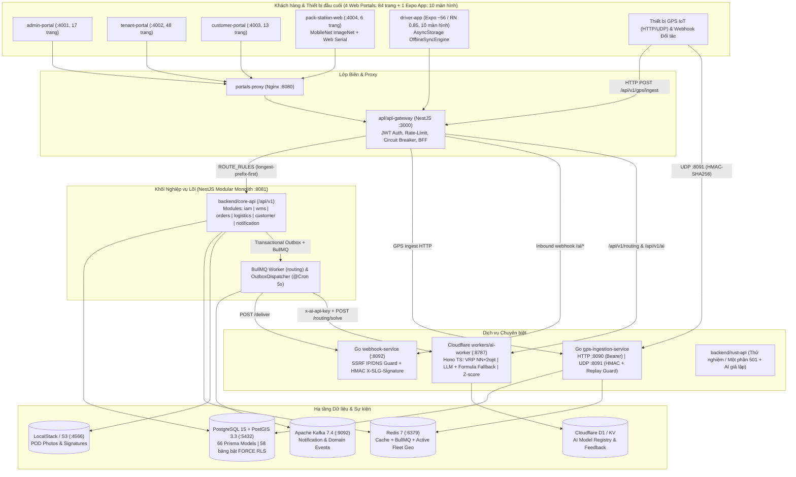
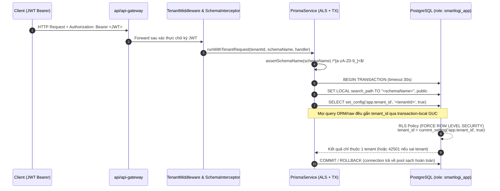
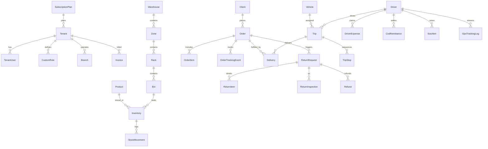
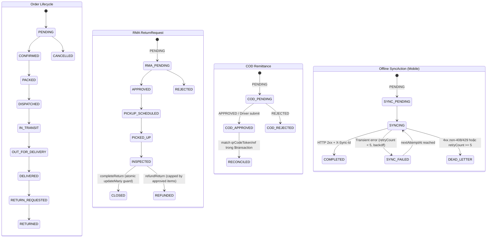

# Kiến trúc Hệ thống & Lược đồ Dữ liệu (As-Is Architecture & ERD)

Tài liệu này mô tả kiến trúc thực tế (As-Is) của SmartLogi AI SaaS sau quá trình hợp nhất modular monolith và gia cố các cổng kiểm soát `G0–G5` (trên nền snapshot baseline `775ba1ce181191054397cb62bb7430530ce33f81`, xác minh CI 6/6 jobs PASSED ở commit `75cf1ea` / Run `43023689371`).

---

## 1. Tổng quan Kiến trúc 5 Runtime & Khách hàng

Hệ thống tách biệt lớp giao diện biên, lớp cổng API/BFF, một ứng dụng nghiệp vụ lõi dạng **Modular Monolith**, hai dịch vụ Go hiệu năng cao, một Edge AI Worker chạy độc lập và một workspace Rust đang ở mức thử nghiệm (`501`/stub).

### Danh mục gói dùng chung (`packages/`)

| Gói | Vai trò thực tế trong Workspace |
|---|---|
| [`packages/prisma-schemas`](../packages/prisma-schemas) | Schema duy nhất của toàn hệ thống (66 model PostgreSQL/PostGIS), migration RLS và test cô lập SQL |
| [`packages/shared-types`](../packages/shared-types) | Định nghĩa `Roles`, `Permissions`, `RolePermissionMap`, decorator `@RequireRoles` / `@ExcludeRoles` / `@RequirePermissions` và [`PermissionsGuard`](../packages/shared-types/src/guards/permissions.guard.ts) |
| [`packages/wms-engine`](../packages/wms-engine) | Thuật toán cấp phát tồn kho `FIFO`/`FEFO`/`LIFO`, `allocateWithCapacity`, `assignPutawayBin`, `generateWave`, `calculateReplenishment` |
| [`packages/offline-sync-engine`](../packages/offline-sync-engine) | Thành phần đồng bộ offline dùng chung trong workspace |
| [`packages/hardware-bridge`](../packages/hardware-bridge) | Bridge giao tiếp cân điện tử / đầu đọc mã vạch Web Serial |
| [`packages/map-components`](../packages/map-components), `ui-kit`, `ui-components`, `ui-tokens` | UI dùng chung giữa các Next.js 15 portals |

---

## 2. Cơ chế Cô lập Đa khách thuê (Multi-Tenancy & PostgreSQL RLS)

Hệ thống bảo vệ dữ liệu đa khách thuê qua **hai lớp phòng thủ độc lập** bên trong [`PrismaService`](../backend/core-api/src/core/prisma/prisma.service.ts) và PostgreSQL 15:

### Quy tắc kỹ thuật quan trọng đã xác minh
1. **Không còn `Scope.REQUEST` trên service**: Thay bằng `AsyncLocalStorage<TenantStore>` (`tenantContext`) gắn TransactionClient (`tx`) và Proxy hỗ trợ gọi lồng nhau (nested `$transaction` tái sử dụng transaction hiện tại).
2. **Fail-Closed theo thiết kế**: Kết nối ứng dụng phải dùng role `smartlogi_app` (`NOSUPERUSER`, `NOBYPASSRLS`) theo [`tenant-isolation.sql`](../packages/prisma-schemas/prisma/tests/tenant-isolation.sql). Khi `app.tenant_id` rỗng hoặc không khớp, PostgreSQL không trả về dòng nào và chặn ghi chéo (`42501 insufficient_privilege`).
3. **58 bảng bật `ENABLE` + `FORCE ROW LEVEL SECURITY`**:
   - **51 bảng nghiệp vụ cốt lõi** từ [`20240616000000_enable_tenant_rls`](../packages/prisma-schemas/prisma/migrations/20240616000000_enable_tenant_rls/migration.sql): `adjustments`, `ai_feedbacks`, `ai_models`, `bins`, `branches`, `categories`, `client_users`, `client_webhooks`, `clients`, `cod_remittances`, `custom_roles`, `cycle_counts`, `deliveries`, `demand_forecasts`, `driver_expenses`, `drivers`, `equipment_checkout`, `file_attachments`, `geofences`, `gps_tracking_logs`, `inventory`, `invoice_line_items`, `notifications`, `order_items`, `order_tracking_events`, `orders`, `pack_station_logs`, `products`, `racks`, `refunds`, `return_inspections`, `return_items`, `return_reasons`, `return_requests`, `role_permissions`, `route_optimization_jobs`, `scan_logs`, `shipping_rates`, `sos_alerts`, `staff_shifts`, `stock_movements`, `task_items`, `tasks`, `tenant_users`, `trip_stops`, `trips`, `user_roles`, `vehicles`, `warehouses`, `wave_picking`, `zones`.
   - **7 bảng tài chính, API key và cấu hình bổ sung** trong đợt gia cố [`20261111000000_harden_tenant_rls_and_audit`](../packages/prisma-schemas/prisma/migrations/20261111000000_harden_tenant_rls_and_audit/migration.sql): `invoices`, `payment_transactions`, `tenant_api_keys`, `feature_flags`, `tenant_settings`, `api_usage_daily`, `tenant_ui_configs`.
4. **8 bảng cấp nền tảng / liên kết gián tiếp không bật RLS**: `Tenant`, `subscription_plans`, `system_admins`, `system_audit_logs` (lọc theo `tenantId` trong controller/service), `system_settings`, `outbox_events` (worker toàn cục), `notification_templates`, `client_api_keys` (gắn qua khóa ngoại `client_id` trỏ bảng `clients` có RLS).
5. **Quyền Platform có kiểm soát (`runAsPlatform`)**: Chỉ được gọi bởi các đường platform (`AdminDashboardController`, đăng nhập/reset mật khẩu tìm tenant theo email, worker nền), tạm bật `set_config('app.bypass_rls', 'on', true)` và khôi phục giá trị cũ trong khối `finally`.

---

## 3. Lược đồ Cơ sở Dữ liệu PostgreSQL & PostGIS (66 Models)

Nguồn chuẩn duy nhất: [`packages/prisma-schemas/prisma/schema.prisma`](../packages/prisma-schemas/prisma/schema.prisma).

> **Lưu ý tên bảng SQL thực tế**: Model `Tenant` không khai báo `@@map`, nên tên bảng PostgreSQL là `public."Tenant"` (PascalCase). Toàn bộ **65 model còn lại** sử dụng `@@map` dạng snake_case (`orders`, `inventory`, `stock_movements`, ...). Mọi truy vấn SQL thô đều truyền `TEXT` chuẩn (không ép kiểu `::uuid`, cho phép ID kiểu CUID hoặc UUID).

### Nhóm thực thể & Quan hệ cốt lõi (ERD logic)

### Danh mục đầy đủ 66 Prisma Models phân theo Miền nghiệp vụ

| Miền (Domain) | Số lượng | Danh sách Model (tên bảng PostgreSQL) |
|---|---:|---|
| **Platform, IAM & Config** | 15 | `OutboxEvent` (`outbox_events`), `Tenant` (`"Tenant"`), `SubscriptionPlan` (`subscription_plans`), `SystemAuditLog` (`system_audit_logs`), `SystemAdmin` (`system_admins`), `TenantUser` (`tenant_users`), `CustomRole` (`custom_roles`), `RolePermission` (`role_permissions`), `UserRole` (`user_roles`), `Branch` (`branches`), `TenantApiKey` (`tenant_api_keys`), `FeatureFlag` (`feature_flags`), `SystemSetting` (`system_settings`), `TenantSetting` (`tenant_settings`), `TenantUiConfig` (`tenant_ui_configs`) |
| **WMS (Kho & Đóng gói)** | 15 | `Warehouse` (`warehouses`), `Zone` (`zones`), `Rack` (`racks`), `Bin` (`bins`), `Category` (`categories`), `Product` (`products`), `Inventory` (`inventory`), `StockMovement` (`stock_movements`), `WavePicking` (`wave_picking`), `Task` (`tasks`), `TaskItem` (`task_items`), `CycleCount` (`cycle_counts`), `Adjustment` (`adjustments`), `ScanLog` (`scan_logs`), `PackStationLog` (`pack_station_logs`), `StaffShift` (`staff_shifts`), `EquipmentCheckout` (`equipment_checkout`) *(17 bảng thực tế khi tính cả ca/thiết bị)* |
| **Clients, Orders & RMA** | 11 | `Client` (`clients`), `ClientUser` (`client_users`), `ClientWebhook` (`client_webhooks`), `ClientApiKey` (`client_api_keys`), `Order` (`orders`), `OrderItem` (`order_items`), `OrderTrackingEvent` (`order_tracking_events`), `ReturnReason` (`return_reasons`), `ReturnRequest` (`return_requests`), `ReturnItem` (`return_items`), `ReturnInspection` (`return_inspections`), `Refund` (`refunds`) *(12 model)* |
| **TMS, Fleet, GPS & Geofence** | 10 | `Vehicle` (`vehicles`), `Driver` (`drivers` - có `last_known_location geometry(Point,4326)` + GIST index), `Trip` (`trips`), `TripStop` (`trip_stops`), `Delivery` (`deliveries`), `DriverExpense` (`driver_expenses`), `CodRemittance` (`cod_remittances`), `SosAlert` (`sos_alerts`), `Geofence` (`geofences` - có `polygon geometry(Polygon,4326)` + GIST index), `GpsTrackingLog` (`gps_tracking_logs`) |
| **Billing, Usage & Misc** | 9 | `Invoice` (`invoices`), `InvoiceLineItem` (`invoice_line_items`), `PaymentTransaction` (`payment_transactions`), `ApiUsageDaily` (`api_usage_daily`), `FileAttachment` (`file_attachments`), `ShippingRate` (`shipping_rates`), `Notification` (`notifications`), `NotificationTemplate` (`notification_templates`), `RouteOptimizationJob` (`route_optimization_jobs`) |
| **AI Metadata & Feedback** | 3 | `AiModel` (`ai_models`), `AiFeedback` (`ai_feedbacks`), `DemandForecast` (`demand_forecasts`) |

*(Tổng đối chiếu chính xác: 66 `model` khai báo trong `schema.prisma`, bao gồm `15 + 17 + 12 + 10 + 9 + 3 = 66`.)*

---

## 4. Các Động cơ Lõi & Máy Trạng thái (Core Engines & State Machines)

### 4.1. Transactional Outbox (`OutboxService` & `OutboxDispatcher`)
- **Ghi đồng bộ trong Transaction**: Nghiệp vụ gọi `OutboxService.enqueue(msg, tx)` để lưu vào `outbox_events` cùng lúc với thay đổi bảng nghiệp vụ.
- **Nhận việc an toàn đa instance**: [`OutboxDispatcher`](../backend/core-api/src/core/outbox/outbox-dispatcher.service.ts) chạy chu kỳ 5 giây (`@Cron('*/5 * * * * *')`), khóa lô tối đa 20 bản ghi bằng `FOR UPDATE SKIP LOCKED`.
- **Chiến lược giao phát (At-Least-Once)**: Tối đa 5 lần thử (`MAX_ATTEMPTS = 5`), lùi thời gian lũy thừa `min(300s, 10 * 2^(attempts-1))`. Sau 5 lần lỗi, sự kiện chuyển sang `FAILED` để vận hành xử lý; hệ thống không tự khẳng định *exactly-once*, nên consumer và webhook receiver phải hỗ trợ `idempotencyKey = event.id`.

### 4.2. Động cơ Kho [`packages/wms-engine/src/index.ts`](../packages/wms-engine/src/index.ts)
- **Cấp phát tồn kho (`FIFO`, `FEFO`, `LIFO`)**: Hỗ trợ `allocateWithCapacity` theo dõi trọng lượng và thể tích **cộng dồn còn lại** của từng bin (`remainingCapacityByBin` được trừ ngay sau mỗi dòng hàng cùng bin, khắc phục lỗi tái sử dụng dung lượng bin).
- **Đề xuất cất hàng (`assignPutawayBin`)**: Chuẩn hóa tỷ lệ lấp đầy không thứ nguyên cho hai đại lượng khác đơn vị (`(currentWeight/maxWeight + currentVolume/maxVolume) / 2`), chọn bin khả dụng ít đầy nhất thỏa mãn cả `weightAvailable` lẫn `volumeAvailable`.
- **Gom sóng lấy hàng (`generateWave`)**: Phân cụm đơn hàng theo độ ưu tiên (`priority`) và lô `waveSize`, tự động ánh xạ `sourceBinId` từ `productBinMap` nếu được truyền vào; thời gian ước lượng dùng công thức heuristic tuyến tính `totalItems * 2` phút (không phải tối ưu đường đi TSP trong kho).

### 4.3. Máy Trạng thái Nghiệp vụ

