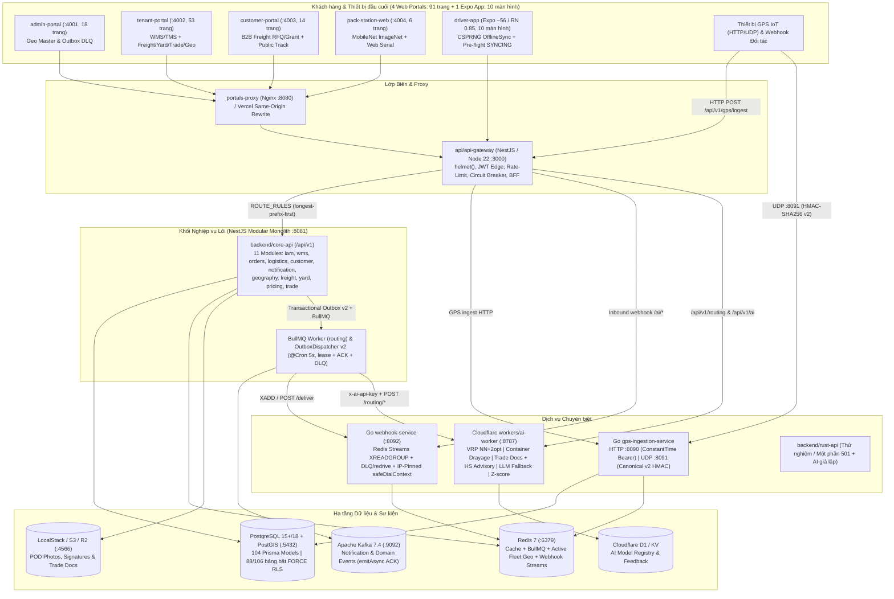
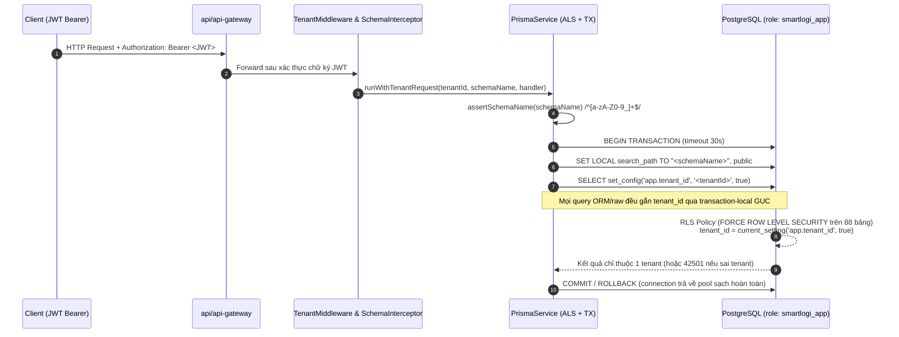
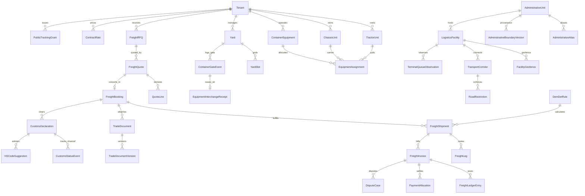
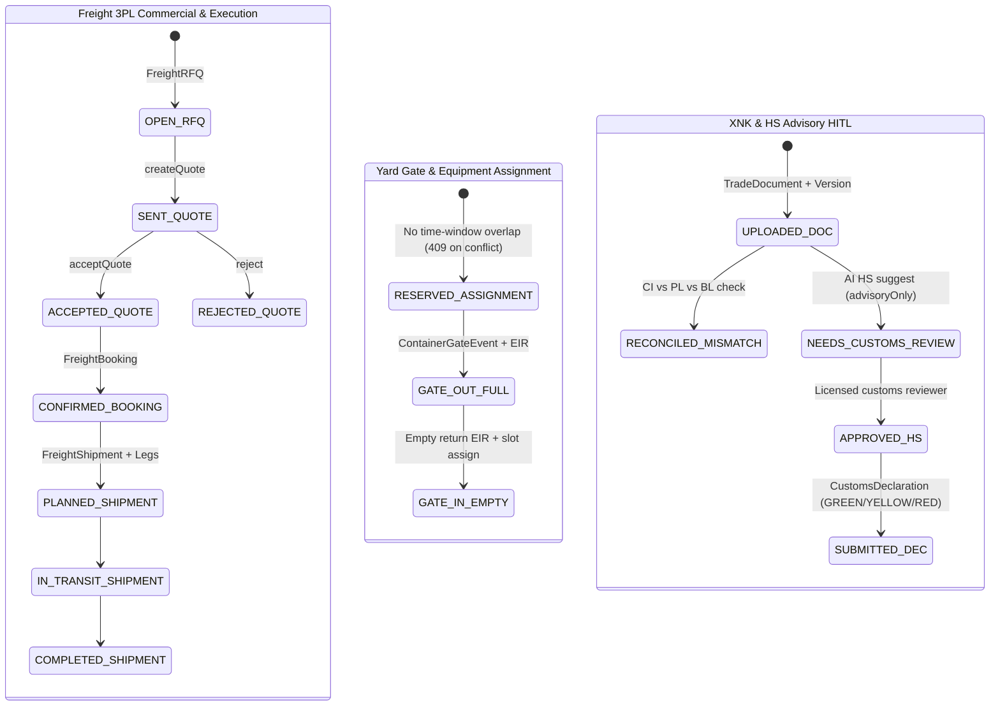

# Kiến trúc Hệ thống & Lược đồ Dữ liệu (As-Is Architecture & ERD)

Tài liệu mô tả kiến trúc thực tế (As-Is) của SmartLogi AI SaaS sau quá trình hợp nhất modular monolith và hoàn thiện các cổng kiểm soát `G0–G7` (kiểm chứng đầy đủ `6/6` CI jobs trên nhánh `feat/smartlogi-enterprise-2026`, commit `4840cce` / Run [`43069842957`](https://github.com/lovemvaf/Logistic_AI_SaaS/actions/runs/43069842957), cùng E2E full-stack cục bộ `12/12` Playwright và `4` dự án Vercel Preview `visionary19`).

---

## 1. Tổng quan Kiến trúc 5 Runtime & Khách hàng

Hệ thống tách biệt lớp giao diện biên, lớp cổng API/BFF, một ứng dụng nghiệp vụ lõi dạng **Modular Monolith (`11` modules)**, hai dịch vụ Go hiệu năng cao, một Cloudflare Edge AI Worker mở rộng nghiệp vụ Freight/XNK và một workspace Rust đang ở mức thử nghiệm (`501`/stub).

### Danh mục gói dùng chung (`packages/`)

| Gói | Vai trò thực tế trong Workspace |
|---|---|
| [`packages/prisma-schemas`](../packages/prisma-schemas) | Schema duy nhất toàn hệ thống (**`104` model** PostgreSQL/PostGIS, **`7` migrations**), chính sách `FORCE RLS` trên **`88`** bảng, test SQL cô lập tenant & bộ seed demo tích hợp [`demo-enterprise.ts`](../packages/prisma-schemas/prisma/seeds/demo-enterprise.ts) |
| [`packages/shared-types`](../packages/shared-types) | Định nghĩa `Roles`, **`50` chuỗi `Permissions`** (thêm `geography`, `freight`, `yard`, `trade`, `pricing`, `tracking-grants`), `RolePermissionMap`, `@RequireRoles` / `@ExcludeRoles` / `@RequirePermissions` và [`PermissionsGuard`](../packages/shared-types/src/guards/permissions.guard.ts) |
| [`packages/wms-engine`](../packages/wms-engine) | Thuật toán cấp phát tồn kho `FIFO`/`FEFO`/`LIFO`, `allocateWithCapacity`, `assignPutawayBin`, `generateWave`, `calculateReplenishment` |
| [`packages/offline-sync-engine`](../packages/offline-sync-engine) | Thành phần đồng bộ offline dùng chung trong workspace với backoff + jitter chuẩn hóa |
| [`packages/hardware-bridge`](../packages/hardware-bridge) | Bridge giao tiếp cân điện tử / đầu đọc mã vạch Web Serial |
| [`packages/map-components`](../packages/map-components), [`packages/ui-kit`](../packages/ui-kit), [`packages/ui-components`](../packages/ui-components), [`packages/ui-tokens`](../packages/ui-tokens) | Thành phần bản đồ Leaflet & hệ giao diện dùng chung giữa 4 Next.js 15 portals |

---

## 2. Cơ chế Cô lập Đa khách thuê (Multi-Tenancy & PostgreSQL `88/106` `FORCE RLS`)

Hệ thống bảo vệ dữ liệu đa khách thuê qua **hai lớp phòng thủ độc lập** bên trong [`PrismaService`](../backend/core-api/src/core/prisma/prisma.service.ts) và PostgreSQL 15+/18:

### Quy tắc kỹ thuật & Phân loại Bảng RLS / Non-RLS (`106` bảng công khai)
1. **Không dùng `Scope.REQUEST`**: Toàn bộ ngữ cảnh tenant đi qua `AsyncLocalStorage<TenantStore>` (`tenantContext`) gắn TransactionClient (`tx`) và Proxy hỗ trợ nested `$transaction`.
2. **Fail-Closed dưới role `smartlogi_app`**: Role ứng dụng phải có `NOSUPERUSER NOBYPASSRLS`. Khi `app.tenant_id` rỗng hoặc không khớp, câu lệnh trả `0` dòng và ghi chéo bị chặn (`42501 insufficient_privilege`).
3. **`88` bảng bật `ENABLE` + `FORCE ROW LEVEL SECURITY`** (xác minh trực tiếp trên PG18 & CI `postgres-rls`):
   - **51 bảng cốt lõi** (`20240616000000_enable_tenant_rls`): `adjustments`, `ai_feedbacks`, `ai_models`, `bins`, `branches`, `categories`, `client_users`, `client_webhooks`, `clients`, `cod_remittances`, `custom_roles`, `cycle_counts`, `deliveries`, `demand_forecasts`, `driver_expenses`, `drivers`, `equipment_checkout`, `file_attachments`, `geofences`, `gps_tracking_logs`, `inventory`, `invoice_line_items`, `notifications`, `order_items`, `order_tracking_events`, `orders`, `pack_station_logs`, `products`, `racks`, `refunds`, `return_inspections`, `return_items`, `return_reasons`, `return_requests`, `role_permissions`, `route_optimization_jobs`, `scan_logs`, `shipping_rates`, `sos_alerts`, `staff_shifts`, `stock_movements`, `task_items`, `tasks`, `tenant_users`, `trip_stops`, `trips`, `user_roles`, `vehicles`, `warehouses`, `wave_picking`, `zones`.
   - **7 bảng tài chính & cấu hình (`20261111000000`)**: `invoices`, `payment_transactions`, `tenant_api_keys`, `feature_flags`, `tenant_settings`, `api_usage_daily`, `tenant_ui_configs`.
   - **4 bảng bảo mật & idempotency (`20261111120000`)**: `client_api_keys` *(đã thêm cột `tenant_id` trực tiếp + FK + `FORCE RLS`)*, `api_idempotency_records`, `public_tracking_grants`, `webhook_deliveries`.
   - **26 bảng Enterprise 3PL, Equipment, Yard, Pricing & XNK (`20261112000000`)**: `tractor_units`, `chassis_units`, `container_equipments`, `equipment_assignments`, `yards`, `yard_slots`, `container_gate_events`, `equipment_interchange_receipts`, `contract_rates`, `surcharge_rules`, `dem_det_rules`, `freight_rfqs`, `freight_quotes`, `quote_lines`, `freight_bookings`, `freight_shipments`, `freight_legs`, `freight_invoices`, `freight_ledger_entries`, `payment_allocations`, `dispute_cases`, `trade_documents`, `trade_document_versions`, `customs_declarations`, `customs_status_events`, `hs_code_suggestions`.
4. **`18` bảng công khai không gắn RLS** (có lý do kiến trúc tường minh):
   - **8 bảng cấp Nền tảng / Worker dùng chung**: `Tenant`, `subscription_plans`, `system_admins`, `system_audit_logs` *(lọc tường minh theo `tenantId` trong `TenantAuditLogsController`)*, `system_settings`, `outbox_events`, `notification_templates`, `event_consumption_ledger`.
   - **8 bảng Địa giới & Hạ tầng Vùng chung TP Đồng Nai 2026**: `administrative_units`, `administrative_aliases`, `administrative_boundary_versions`, `logistics_facilities`, `facility_geofences`, `transport_corridors`, `road_restrictions`, `terminal_queue_observations`.
   - **2 bảng hệ thống Migration & PostGIS**: `_prisma_migrations`, `spatial_ref_sys`.
5. **Quyền Platform (`runAsPlatform`)**: Chỉ kích hoạt bên trong các đường nền tảng/hệ thống có kiểm soát, tạm đặt `app.bypass_rls = 'on'` trong transaction và khôi phục trong khối `finally`.

---

## 3. Lược đồ Cơ sở Dữ liệu PostgreSQL & PostGIS (`104` Models)

Nguồn chuẩn duy nhất: [`packages/prisma-schemas/prisma/schema.prisma`](../packages/prisma-schemas/prisma/schema.prisma) cùng **`7` migrations** từ `20240615000000` đến `20261112000000`.

> **Lưu ý tên bảng & kiểu ID**: Model `Tenant` ánh xạ bảng `public."Tenant"` (PascalCase); **103 model còn lại** dùng `@@map` snake_case. Không sử dụng `::uuid` trong SQL thô để tương thích hoàn toàn ID dạng UUID và CUID.

### Quan hệ Thực thể Mở rộng Enterprise & Địa giới 2026 (ERD Logic)

### Bảng Tổng hợp `104` Prisma Models theo Miền Nghiệp vụ

| Miền (Domain) | Số Model | Danh sách Model (tên bảng chính) |
|---|---:|---|
| **Platform, IAM, Hardening & Config** | `19` | `OutboxEvent` (`outbox_events`), `EventConsumptionLedger` (`event_consumption_ledger`), `ApiIdempotencyRecord` (`api_idempotency_records`), `PublicTrackingGrant` (`public_tracking_grants`), `WebhookDelivery` (`webhook_deliveries`), `Tenant` (`"Tenant"`), `SubscriptionPlan` (`subscription_plans`), `SystemAuditLog`, `SystemAdmin`, `TenantUser`, `CustomRole`, `RolePermission`, `UserRole`, `Branch`, `TenantApiKey`, `FeatureFlag`, `SystemSetting`, `TenantSetting`, `TenantUiConfig` |
| **WMS (Kho & Đóng gói)** | `17` | `Warehouse`, `Zone`, `Rack`, `Bin`, `Category`, `Product`, `Inventory`, `StockMovement`, `WavePicking`, `Task`, `TaskItem`, `CycleCount`, `Adjustment`, `ScanLog`, `PackStationLog`, `StaffShift`, `EquipmentCheckout` |
| **Clients, Orders & RMA** | `12` | `Client`, `ClientUser`, `ClientWebhook`, `ClientApiKey` (`client_api_keys` — có `FORCE RLS`), `Order`, `OrderItem`, `OrderTrackingEvent`, `ReturnReason`, `ReturnRequest`, `ReturnItem`, `ReturnInspection`, `Refund` |
| **TMS, Fleet, GPS & Geofence** | `10` | `Vehicle`, `Driver`, `Trip`, `TripStop`, `Delivery`, `DriverExpense`, `CodRemittance`, `SosAlert`, `Geofence`, `GpsTrackingLog` |
| **Billing, Usage & Misc** | `9` | `Invoice`, `InvoiceLineItem`, `PaymentTransaction`, `ApiUsageDaily`, `FileAttachment`, `ShippingRate`, `Notification`, `NotificationTemplate`, `RouteOptimizationJob` |
| **AI Metadata & Feedback** | `3` | `AiModel`, `AiFeedback`, `DemandForecast` |
| **TP Đồng Nai 2026 Geography & Infrastructure** | `8` | `AdministrativeUnit`, `AdministrativeAlias`, `AdministrativeBoundaryVersion`, `LogisticsFacility` (`outsideCity`), `FacilityGeofence`, `TransportCorridor`, `RoadRestriction`, `TerminalQueueObservation` |
| **Equipment & Yard / EIR** | `8` | `TractorUnit`, `ChassisUnit`, `ContainerEquipment`, `EquipmentAssignment`, `Yard`, `YardSlot`, `ContainerGateEvent`, `EquipmentInterchangeReceipt` |
| **Freight 3PL, Pricing & DEM/DET / AR-AP** | `13` | `ContractRate`, `SurchargeRule`, `DemDetRule`, `FreightRFQ`, `FreightQuote`, `QuoteLine`, `FreightBooking`, `FreightShipment`, `FreightLeg`, `FreightInvoice`, `FreightLedgerEntry`, `PaymentAllocation`, `DisputeCase` |
| **XNK Trade Documents & Customs** | `5` | `TradeDocument`, `TradeDocumentVersion`, `CustomsDeclaration`, `CustomsStatusEvent`, `HSCodeSuggestion` |

*(Tổng đối chiếu chính xác: `19 + 17 + 12 + 10 + 9 + 3 + 8 + 8 + 13 + 5 = 104` model trong `schema.prisma`.)*

---

## 4. Động cơ Lõi, Địa giới TP Đồng Nai 2026 & Máy Trạng thái

### 4.1. Transactional Outbox v2 & DB Idempotency (`SHA-256` + `409`)
- **Outbox v2** ([`outbox-dispatcher.service.ts`](../backend/core-api/src/core/outbox/outbox-dispatcher.service.ts)): Dùng `eventId`, `payloadHash`, `correlationId`, lease lock `leaseUntil` + `lockedBy` để thu hồi tác vụ treo giữa nhiều instance (`reclaim expired leases`), gọi `kafka.emitAsync()` chờ broker ACK thật sự thay vì fire-and-forget, chuyển sang **`DEAD_LETTER`** khi vượt `MAX_ATTEMPTS = 5` kèm API/UI redrive, và đối chiếu tiêu thụ phía consumer qua `EventConsumptionLedger`.
- **DB Idempotency** ([`idempotency.interceptor.ts`](../backend/core-api/src/core/http/idempotency.interceptor.ts)): Lưu bền vững vào bảng PostgreSQL `api_idempotency_records` (khóa duy nhất theo `(tenant_id, principal_id, operation, idempotency_key)` + `FORCE RLS`). Lưu dấu vân tay SHA-256 của request body (`body_sha256`):
  - Trùng key + đang `PROCESSING` -> trả `409 Conflict`.
  - Trùng key + **khác `body_sha256`** -> trả `409 Conflict` ngăn replay sai payload.
  - Trùng key + giống payload + đã `COMPLETED` -> trả replay kết quả cũ an toàn.

### 4.2. Chuẩn hóa Địa giới TP Đồng Nai 2026 (95 ĐVHC) & Phân tách Hạ tầng Cảng Ngoài Thành phố
- Danh mục [`administrative_units`](../packages/prisma-schemas/prisma/schema.prisma) lưu đúng **`95` đơn vị hành chính (`33` phường + `62` xã)** theo tham chiếu quy hoạch TP Đồng Nai 2026 (`PENDING_OFFICIAL_CODE`, `NO_OFFICIAL_POLYGON` — bảo tồn provenance trung thực đến khi cơ quan nhà nước ban hành mã/polygon chính thức).
- 19 `AdministrativeAlias` ánh xạ tên địa bàn cũ (VD: `Tam Hiệp cũ`, `KCN Amata`, `Long Bình Tân`) sang 95 ĐVHC chuẩn.
- 10 `LogisticsFacility` phân tách rõ các trung tâm/ICD/depot nội tỉnh (ICD Biên Hòa, KCN Amata, ICD Nhơn Trạch, Khu logistics Sân bay Long Thành, Cảng Phước An...) với **cảng kết nối vùng nằm ngoài ranh TP Đồng Nai (`outsideCity: true`)** gồm **Cảng Cát Lái (TP.HCM)** và **Cụm cảng Cái Mép–Thị Vải (BR–VT)** trên **`4` tuyến hành lang vận tải (`TransportCorridor`, thuộc 3 hướng `NORTH`, `CENTRAL`, `SOUTH`)** kèm hạn chế tải trọng/giờ cấm (`RoadRestriction`).

### 4.3. Máy Trạng thái Enterprise (Freight, Yard/EIR, DEM/DET & XNK)

