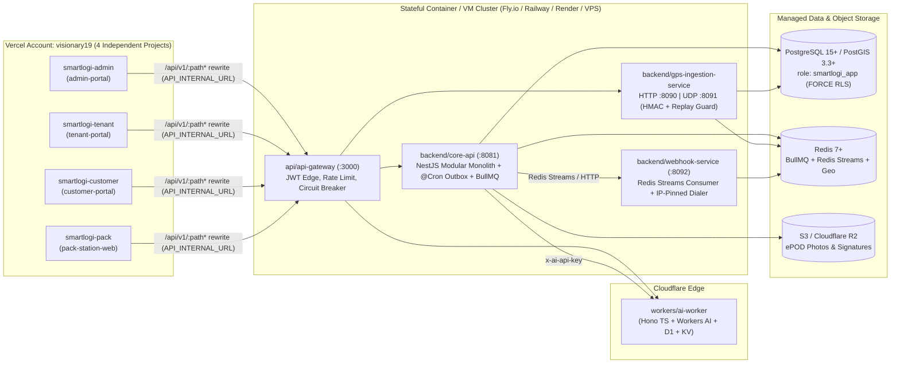

# Kiến trúc Triển khai Đa Hạ tầng (`DEPLOYMENT_TOPOLOGY.md`)

SmartLogi AI SaaS tách bạch rạch ròi lớp giao diện Web biên (Vercel Serverless/Edge) khỏi cụm dịch vụ trạng thái dài hạn, kết nối CSDL/Queue và nhận gói tin IoT UDP.

---

## 1. Sơ đồ Phân bổ Hạ tầng (Production Target vs Vercel Hobby Boundary)

---

## 2. Lý do Phân tách Hạ tầng (Tương thích Thực tế)

1. **4 Cổng Next.js trên Vercel (`smartlogi-admin`, `smartlogi-tenant`, `smartlogi-customer`, `smartlogi-pack`)**:
   - Đều là Next.js 15 App Router, phù hợp hoàn toàn với Vercel Hobby CDN + SSR/Edge Rewrites.
   - Proxy cùng origin `/api/v1/:path*` giúp toàn bộ cookie/Bearer token tránh lỗi CORS cross-site và che địa chỉ backend thật khỏi client.
2. **Tại sao `backend/core-api`, `gps-ingestion-service`, `webhook-service`, Postgres và Redis KHÔNG chạy trên Vercel Serverless**:
   - `backend/core-api` giữ Postgres connection pool phục vụ **`AsyncLocalStorage` transaction-local `SET LOCAL search_path` & `app.tenant_id` (`FORCE ROW LEVEL SECURITY`)**, chạy `@Cron` `OutboxDispatcher` mỗi 5 giây với lease reclaim và `BullMQ` worker. Serverless function ngắt vòng đời sau mỗi request không phù hợp cho worker nền và transaction pool giữ trạng thái dài.
   - `backend/gps-ingestion-service` mở socket **`UDP :8091`** nhận telemetry IoT có chữ ký HMAC-SHA256. Vercel Serverless chỉ nhận HTTP/HTTPS.
   - `backend/webhook-service` duy trì consumer group `Redis Streams` (`XREADGROUP` + `XAUTOCLAIM` + DLQ) và `DialContext` ghim IP chống DNS rebinding TOCTOU SSRF.
3. **Cloudflare Worker (`workers/ai-worker`)**:
   - Stateless Hono API Worker, chạy tốt trên Cloudflare Workers + D1 SQLite (`SCHEMA_SQL`) + KV cache + Workers AI binding (hoặc fallback công thức tất định khi chưa cấp binding).
4. **Database & Queue Compatibility**:
   - **PostgreSQL + PostGIS**: Bắt buộc hỗ trợ extension `postgis` và tách tối thiểu 2 role: `migrator` (chạy `prisma migrate deploy`) và **`smartlogi_app`** (`NOSUPERUSER NOBYPASSRLS`) cho runtime.
   - **Redis >= 5.0 (`redis:7-alpine`)**: Bắt buộc vì BullMQ v5 và Redis Streams (`webhook-service`) sử dụng các lệnh stream/Lua hiện đại không tương thích hoàn toàn với Redis 3.x cũ.

---

## 3. Cổng Mạng & Bảo mật Liên Dịch vụ

- Chỉ `api-gateway` (HTTPS 443) và cổng UDP GPS (`:8091` nếu bật thiết bị thực địa) mở ra Internet; `core-api`, `webhook-service`, `PostgreSQL`, `Redis` nằm trong mạng riêng (private VPC/subnet).
- Toàn bộ request đi qua `api-gateway` tuân thủ `helmet()`, giới hạn tốc độ và xác thực JWT trừ danh sách `PUBLIC_PATHS` đã khóa tối thiểu (`/health`, `/api/v1/health`, `/api/v1/public`, `/api/v1/track`, `/api/v1/*/auth`, `/api/v1/gps/ingest`, `/api/v1/webhooks/stripe`).
- Chi tiết kịch bản docker local/staging đối chiếu xem thêm tại [`docs/operations-runbook.md`](../operations-runbook.md).
